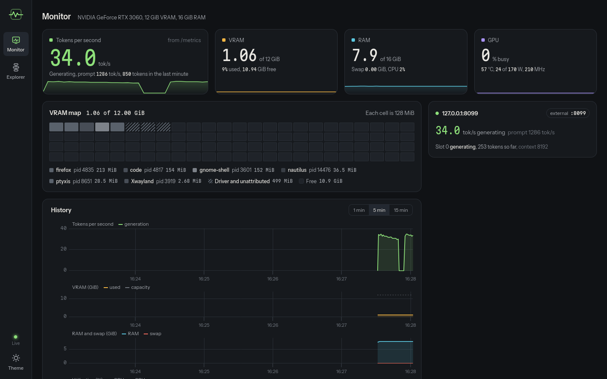
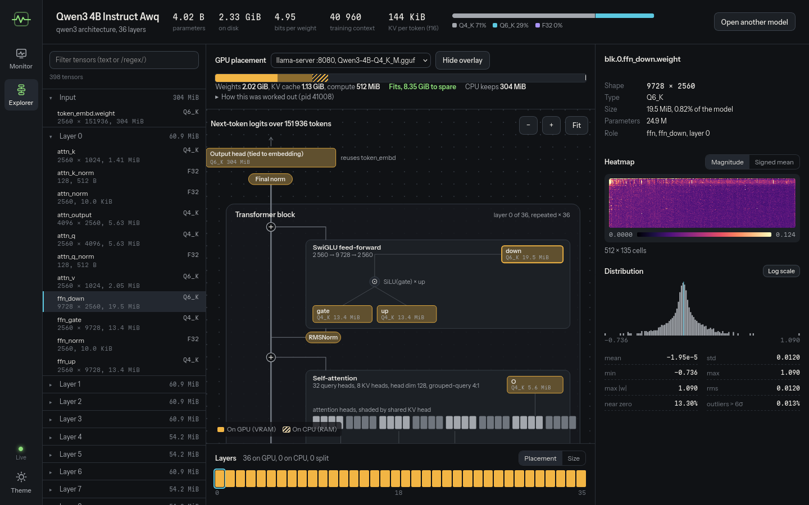

# ai-health

[](https://github.com/corentinravoux/ai-health/actions/workflows/tests.yml)
[](LICENSE)

A Linux desktop app for watching a local LLM run on your own machine, and
for understanding the model itself.

- **Monitor** (live): tokens per second, VRAM, RAM and swap, GPU load, the
  llama.cpp processes and the flags they were started with, per-slot
  progress and context fill, and warnings that tell you what to change.
- **Explorer** (on demand): opens a GGUF file and draws its architecture as
  a diagram, lets you inspect every weight tensor (heatmap, distribution,
  statistics), and shows which layers your llama-server flags put on the GPU
  and whether the model fits in VRAM.




Built for llama.cpp on an NVIDIA GPU. It only observes: it never starts,
stops or reconfigures your servers.

## Install

The app runs in the single Python environment of this PC, `~/Software/venv`
(Python 3.14, created with `--system-site-packages` so the system GTK
bindings are visible to pywebview).

```bash
UV=~/.local/bin/uv; PY=~/Software/venv/bin/python
$UV pip install --python $PY -e ~/Software/llama.cpp/gguf-py   # gguf, tracks your llama.cpp
$UV pip install --python $PY -e "~/Software/ai-health[desktop,dev]"
~/Software/ai-health/scripts/install-desktop-entry.sh          # adds it to the app menu
```

The native window uses GTK/WebKit2 (`gir1.2-webkit2-4.1`, present on Ubuntu
26.04 desktop installs).

## Run

```bash
ai-health                       # native window
ai-health --browser             # same UI in your browser
ai-health --open ~/models/x.gguf
ai-health --extra-server 127.0.0.1:8099   # also probe a server with no local process
```

Keys: `1` monitor, `2` explorer. The theme toggle is in the left rail.

## How the numbers are obtained

| Number | Source |
|---|---|
| GPU, VRAM, per-process VRAM | NVML (`nvidia-ml-py`); falls back to `nvidia-smi` when the driver hides per-process memory |
| RAM, swap, CPU, threads | `psutil`; per-process swap from `VmSwap` in `/proc/<pid>/status` |
| Processes and flags | `llama`/`llama-*` executables; flags from `/proc/<pid>/cmdline` and `LLAMA_ARG_*` environment variables; the port from the listening socket (the default changed from 8080 to 9931 across llama.cpp versions) |
| Tokens per second, live | `/slots`: tokens decoded between two samples, while a request is running |
| Tokens per second, exact | `/metrics` (start llama-server with `--metrics`): decode tokens over decode time. llama-server only updates these counters when a request finishes, so the readout switches to this value at the end of each request |
| Context fill | `/slots`: prompt tokens + tokens decoded, against the slot's `n_ctx` |

The app samples once per second and keeps 15 minutes of history in memory.
With a model loaded, one sample costs about 20 ms of CPU (2 % of one core,
0.2 % of a 12-thread CPU) and the backend holds ~50 MB of RAM; swap is read
from `/proc/<pid>/status`, not from smaps, which would cost ~165 ms per sample. Probes to llama-server time
out after 300 ms, so a busy server never stalls the monitor.

## Placement overlay

Given a running server (or flags you type), the explorer colours each tensor
by where llama.cpp puts it. The rules come from the llama.cpp source
(`src/llama-model.cpp`, `common/common.h`, `src/llama-model-loader.cpp`):

- `token_embd` (the input layer) always stays on the CPU.
- With `-ngl N`, repeating layer `i` is on the GPU when `i ≥ n_layer + 1 − N`;
  the output layer counts as index `n_layer`. `all` means everything.
- `--cpu-moe`, `--n-cpu-moe N`, `--n-cpu-ffn N` and `-ot regex=BUF` move
  matching tensors; overrides are matched in order and the first match wins.
- `-ngl auto` with `--fit on` (the default) depends on free VRAM at load
  time. ai-health simulates it (experts to CPU first for MoE models, then
  fewer layers) and marks the result **estimated**.

The VRAM estimate is weights on the GPU, plus the KV cache
(`2 × attention layers × ctx × kv heads × head dim × cache type size`,
skipping linear-attention and state-space layers), plus a rough compute
buffer. Checked against a real server: `-ngl 12` on Qwen3-4B gave exactly the
layers llama.cpp reported ("offloaded 12/37 layers"), and an estimate of
1.47 GiB against 1.49 GiB used.

## Weight inspector

Tensors are memory-mapped and dequantized one at a time with `gguf-py`
(requests are serialised and duplicates share one result). Large tensors are
row-sampled (at most 8192 rows and 4 M values, about 60 MB of working memory)
and every heatmap is reduced to
at most 512 × 512 cells, as the largest |w| or the signed mean per cell.
Quantization types that `gguf-py` cannot dequantize are reported instead of
drawn.

## External viewers

If installed, the explorer offers buttons to open the same file in
[Netron](https://github.com/lutzroeder/netron) (experimental GGUF support) and
in [Google Model Explorer](https://github.com/google-ai-edge/model-explorer)
with the [`model-explorer-gguf`](https://pypi.org/project/model-explorer-gguf/)
adapter:

```bash
~/.local/bin/uv pip install --python ~/Software/venv/bin/python netron model-explorer model-explorer-gguf
```

## Development

```bash
~/Software/venv/bin/python -m pytest                       # tests use fakes and tiny synthetic GGUFs
python -m ai_health.devtools.fake_server --port 8099       # a fake llama-server with moving counters
python -m ai_health.devtools.make_demo_gguf demo.gguf --experts 32
python -m ai_health.devtools.screenshot out.png --mode explorer --open demo.gguf
```

The front end is plain HTML, CSS and ES modules with no build step;
uPlot and the fonts (Instrument Sans, Martian Mono, SIL OFL) are vendored in
`ai_health/static/vendor/`, so the app works offline.

## License

MIT, see [LICENSE](LICENSE).
